# 结果：小样本热门估计

英文版：[`02_results_en.md`](02_results_en.md)。预登记的计划：[`01_preregistration_zh.md`](01_preregistration_zh.md)。
下面所有数字都来自 `results/small_sample_popularity/03_tables/`；所有图都在 `04_figures/`。
在 11 个公开数据集上跑了 117,069 个小任务，外加 1,220 个新种子复现任务，通宵在一台笔记本上完成，风扇始终保持空闲转速。

## 1. 一段话的答案

只用几百个人建出来的热门榜，在"软指标"上就已经很接近全群体的榜（N = 400 时 NDCG@100 约 0.88），不过精确的前 10 名离定下来还很远。**更大的差距来自时间。**
以群体**接下来**真正的选择为参照，它"更早的榜"和"之后的榜"之间的距离，远大于抽样差距，在 10 个数据集里的 10 个都成立。
我们试过的近期感知方法只能弥补其中很小一部分（榜单层面中位数 +0.013，对应 0.66 的差距；对留出的人 +0.002）。
同一个样本训练的个性化模型，在最大的被测样本量（最多 4,000 人）处仍在提升，而热门榜早得多就到了自身最好成绩的 95% 以内；
在事后加做的小 N 阶段里，7 个数据集中的 3 个，只要 20 个人个性化就能胜过热门榜。
**我们预登记的三个预测，按原文写的都没有成立**：C1 无定论，C2 被证伪，C3 混合。原因见第 2 节，以及我们对自己最初解释所做的检验。

## 2. 三个预登记假设的记分卡

| 假设 | 预测 | 结论 | 数据说了什么 |
| --- | --- | --- | --- |
| C1 广度胜过深度 | 保留的总选择数相同时，很多人每人几条，比少数人每人很多条更好 | **无定论** | 46 个（数据集，预算）对里 61% 偏向广度；合并差值 +0.0005 NDCG@100，区间 [-0.003, +0.004]。对朴素计数，广度和深度的质量大致相当。对统计上无偏的加权估计，**深度更好**（-0.008，区间 [-0.012, -0.005]）。 |
| C2 诚实的混合 | 只用样本内部选出的混合，从不比较好的单一名单差，有时比两者都好 | **被证伪**（两个登记的证伪条件都触发） | 132 个格子里，混合与较好单一名单相差不超过 0.002 的只占 70%（低于 75% 即证伪）；平均而言它反而**更差** 0.0018（区间 [-0.0029, -0.0008]），7 个数据集里只有 1 个更好。比两者都好的格子占 25%（要求 20%：达到）。随机藏起选择**并没有**比按时间藏更相信个性化（78 个可判定格子里占 38%；不超过 50% 即证伪）。 |
| C3 交叉样本量 | 存在一个样本量 N*，之后个性化模型胜过热门榜，并且随历史变长而变小 | **混合** | k = all 时，7 个数据集里 5 个存在 N*（要求 5：达到）；k = 10 时 3 个（要求 4：未达到）。没有数据集的 N* 随 k 增大而上升。k = all 时有 4 个数据集的 N* 在登记的最小样本量（100）或以下；事后加做的小 N 阶段里，3 个数据集在 20 人或以下。 |

我们对自己最初的解释做了检验（`03_tables/an_followups_verdicts.json`）：

- **C1。** "同一个人多给几条选择，带来的信息和换一个新人差不多"只是在重复结果。我们能证明的是：广度让榜单更**稳定**——在 46 个对里的 39 个，宽格子在不同抽样之间的标准误更小（中位数比值 0.88），而平均质量相同。
  加权估计在小 k 时的损失，最可能是权重方差（每条选择乘以 历史长度 / k），而不是信息量问题。
- **C2。** 用来挑混合比例的样本内留出检验，几乎没有超过基准比例的判断力：个性化在验证小组上胜过热门的抽样占 33%，所以永远猜"热门更好"有 67% 是对的；按时间留出的检验对的比例是 68%。
  它还高估个性化的好处（按时间藏高估 +0.014，随机藏 +0.017），这与混合平均更差相吻合。

## 3. 值得写成论文的发现（除特别说明外都是探索性的）

1. **漂移比抽样误差更大（X10，10/10 个数据集）。** 以"未来的真相"为参照，"群体更早的榜"和"之后的榜"之间的差距，远远大于 1,000 人样本榜和全量榜之间的差距
   （验证小组 NDCG@100：中位数 0.021 对 0.000；对照真相榜时 0.66 对 0.003）。抽样差距在验证小组上接近 0，部分原因是这个指标不灵敏；请和榜单层面的数字一起读。图：`an_explore_a_x10_drift_vs_sampling.png`。
2. **"近期"会翻转目标的符号（X7）。** 近期窗口样本，比同样大小的均匀样本更能预测群体之后的榜（NDCG@100 中位数 +0.037，11 个数据集里的 10 个），而对"更早的完整榜"更差（-0.163，这是构造上的必然）。对留出的人提升很小：中位数 +0.002，在 gowalla 和 lastfm-1k 为负。只取最近几行时，11 个里有 8 个翻转。图：`an_explore_b_x7_recency.png`。
3. **按近期加权的计数有帮助（X12）。** 在 223 个格子里，有 179 个胜过朴素计数，只有 2 个输（榜单层面中位数 +0.013 NDCG@100；在留出的人身上提升一致但很小，最多约 +0.006）。对照同一个近期窗口的得分，它在 223 个格子里输了 119 个，所以是拿一个目标换另一个目标。图：`an_window_x12_decay_minus_count_kall.png`。
4. **两种学习速度（X17）。** 从 N = 100 到最大被测 N，热门榜在验证小组上的得分中位数增长 1.22 倍，最好的个性化模型增长 1.94 倍。个性化曲线起点很低，这会夸大比值；图中每条曲线都按自己在最大 N 处的值缩放。7 个数据集里有 4 个，热门榜至少提早两个网格步就达到自身最好成绩的 95%；N = 4,000 以外没有观测。图：`an_curves_two_speeds.png`。
5. **交叉点比登记的网格能看到的更低（C3 的配套检验，事后加做）。** 小 N 阶段是在登记网格显示出左删失之后才加的，那里的对照是同样那几个人建出的热门榜。k = all 时，ml-latest、amazon-software、kuairand-pure 在 N ≤ 20 就是个性化胜出，ml-1m 在 100，gowalla 在 1,000；两个较小的 Amazon 数据集到 2,000 都没有出现。只统计模型够得着的物品时，amazon-video-games 也在 2,000 出现。图：`an_c3_checks_small_n.png`。
6. **无偏并不更好（X15）。** 统计上无偏的加权计数，在 50 个（数据集，k）序列里的 47 个中从不胜过朴素计数，或者只有在 N 达到群体 10% 以上时才胜过：教科书上的偏差-方差权衡，被量出来了。
7. **排名的不确定性（X5）。** 朴素 bootstrap 排名区间对真实排名 51-200 只覆盖 0.85（中位数），79% 的格子低于 0.93；Mogstad 等人的置信集在每个格子里都达到 0.95，但宽了 3.0 倍。图：`an_explore_b_x5_coverage.png`、`an_explore_b_x5_widths.png`。
8. **隐私（X9，混合）。** ε ≥ 2 且 N ≥ 2,000 时，中心化差分隐私保留非隐私质量的中位数 0.86；本地差分隐私需要中位数 50 倍的人数（这是下界）。噪声使前 10 名重合度下降 96%，前 100 名下降 93%：损失并不像预测的那样集中在榜首。
9. **子群体的方向反了（X8，预测失败）。** 一个真实子群体与全局榜差异越大，用它自己的样本胜过全局榜所需的样本量反而**越小**（Spearman -0.44，区间 [-0.56, -0.31]）。我们预登记的方向是错的。这个数字有一部分来自删失：从未达到交叉点的 70 个序列恰好是差异度较低的。在确实达到的 94 个序列里，相关为 -0.20（区间 [-0.37, -0.01]），仍为负但很弱。X8 的后半部分也失败了：只有 7% 的序列里，收缩榜在每个 N 上都不比两个单一名单差。
10. **样本分不出自己每次抽样的好坏（X14，混合）。** bootstrap 能很好地预测榜单质量的水平（N ≥ 200 时预测/真实比值中位数 1.00），但在不同抽样之间，预测和真实质量的相关性只有 0.18（Spearman 中位数）。注意这里 NDCG 接近 1，所以单看比值，证据很弱。
11. **跨数据集的缩放规律（X3，混合）。** 拟合出的误差指数，与数据集的头部有多重（Zipf 斜率）有秩相关：11 个数据集上 k = all 时 0.54，k = 5 时 0.76（我们预测高于 0.6）。
    幂律只在 k = all 的 11 个数据集里 4 个胜过指数形式的备选，k = 5 时是 0 个，所以"所有指标共用一条幂律"太简单了。图：`an_explore_a_x3_exponent_vs_zipf.png`。
12. **向旧榜收缩（X2，不支持）。** 把新样本与旧榜混合，在窗口真相上最多提升 0.76 NDCG@100，但提升在最小的样本处最大（中位数 N = 20），并不像预测的那样出现在交叉点附近。图：`an_window_x2_window_shrinkage_gain.png`。

## 4. 惊喜搜索发现了什么

我们扫描了 40,356 个比较（非单调曲线、顺序反转、交互、跨数据集符号差异、隐私噪声"帮忙"），并做了假发现控制。在能够复现的四个类别里，分别有 443、325、1,802 和 189 个比较通过；
另外两个类别（253 个和 27 个）因为新数据里没有它们对应的格子，无法重跑，所以不算发现。我们对其中最大的 50 个合格候选（效应不小于 0.01，且不依赖主网格的 `shrunk` 估计）
用新的随机种子重跑：**50 个全部复现**（新种子下方向相同且 p < 0.05；数据和验证小组都没变，所以只检验了抽样噪声）。这里的"复现"指"这是这批数据的稳定性质"，不等于"重要"：多数是小 N 的假象
（比如把样本占比和全局占比做朴素线性混合，会让噪声大的抽样物品在 N = 20 时排到全局热门物品之上），以及签到类数据集上广度和深度的交互。
有两个类别（混合权重出现"谷"，和隐私噪声"帮忙"）什么也没发现。详见 `03_tables/hunt_candidates.csv`。

## 5. 建议的论文叙事

> *小样本热门估计，首先是一个漂移问题，然后才是抽样问题。* 几百个人就能给出一份接近"那个时刻"群体榜的清单；错的是那个时刻。
> 我们试过的近期感知抽样和加权，只修复了这个差距的一小部分（榜单层面约 2%），所以诊断是扎实的，修复还是开放的工作。
> 个性化在热门榜已经饱和的地方继续提升，而在样本内部选混合比例这条路没有走通。

这个叙事**不**声称：广度胜过深度、混合是安全的、一个简单规则胜过样本内调参（我们没有测试过任何这样的规则），或者排名的 bootstrap 区间是校准良好的（朴素的并不是）。
"漂移"这个数字是拿未来的真相与可行的样本相比，所以它是任何方法所能弥补的上限，而不是实测的损失。

## 6. 引用数字前请先读的局限

- **候选集上限。** 这里的模型只在 1,500 个物品里挑。验证小组真实后续选择落在这个候选集内的比例：ml-1m 为 88%，但 ml-latest 只有 37%，amazon-video-games 11%，gowalla 6%（`03_tables/cand_share.csv`）。C2、C3 按登记的标准 NDCG 来读；候选集内的版本放在旁边（`an_c3_checks`）。
- **左删失。** 登记网格里在 N = 100 找到的每个交叉点，只能说"在 100 或以下"。额外的小 N 阶段为部分数据集解决了这个问题。
- **验证小组。** ml-1m 的验证小组只有 194 人，其他数据集最多 1,500 人；ml-1m 和 Amazon 上的时间并列，使"按时间藏"变成部分随机。
- **并列与饱和。** 对全量榜的 NDCG@100 在大样本时接近 1，微小差异很难读；我们报告区间和效应大小，不只报结论。
- **不是真正的小群体。** 样本是从群体里随机抽的，子群体阶段除外。
- **评审。** 代码和确认性分析是由同一服务商的子智能体评审的（不是外部审计）。它们发现了真实的问题（嵌套的旧榜、有偏的权重、按对象编号做键的缓存、可能让工作进程冻结的调度器），都已修复，并记录为预登记修订 A1-A15。

- **验证小组的不确定性。** 每个 N* 和每个 C2(b) 的区间都是针对一个固定验证小组、基于 20 次抽样得到的；验证小组自身的抽样误差（ml-1m 上 194 人）不在其中。132 个 C2(b) 检验没有做多重比较校正。
- **评审者建议的后续工作：** (1) 在真相 B 上，把近期方法与更早的榜和旧榜比较，半衰期在样本内部选出；(2) 用第二个不相交的验证小组，并对验证小组里的人做 bootstrap，重做 C2 和 C3，同时把简单的固定规则（"k = all 时一律个性化"）与混合比较；(3) 在 gowalla、amazon-video-games、ml-latest 上取消 1,500 个物品的上限。

## 7. 运行有多安静

风扇转速中位数 1,463 rpm（这台机器空闲时约 1,450），第 99 百分位 1,619，最大 1,742，共 5.3 个受调度的小时；运行前的重负载测试里，两个工作进程就把同样的风扇推到了 2,360 rpm。调度器冻结过工作进程两次，从未触及硬性上限（平滑后的温度最高 73.3 °C；每秒的原始读数最高 81.9 °C，3.4% 的样本超过 78 °C，风扇却没有反应，所以调度器用的是 25 秒平均值）。只用 CPU（没有用 GPU）；最多 4 个工作进程（通常 2 到 3 个）；工作进程内存峰值 2.2 GB，预算为 8 GB。笔记本自己的交换空间在夜里从 26 GB 增长到 32 GB（来自其他应用），可用磁盘有一次降到 10.6 GB（下限是 10 GB），所以请留意磁盘空间。图：`safety_fans_and_temperature.png`；数据：`00_safety/safety_summary.json`。

## 全部结果（按顺序）

每一块包含：假设、结论、白话解读、事先定好的判定规则，以及图。数值直接来自 `results/small_sample_popularity/03_tables/`。

### 确认性假设

这一块背后的数字：`results/small_sample_popularity/03_tables/an_confirm2_*.csv` 和 `an_confirm2_verdicts.json`。

#### C1. 广度胜过深度：同样的记录总数，人多比每人记录多更能估准名单（修订规则 A10） — **混合**

字面检验（普通计数，真值 A，只看最宽的格子 N 不超过群体 5% 的组合）：在 46 个组合中，人多的名单更好的有 28 个（61%；支持要求至少 75%，不超过 50% 则被证伪，介于两者之间为无定论）。合并差（人多 减 记录多）为 +0.0005（95% 区间 -0.0028 到 +0.0041；要求区间在 0 之上且差不小于 0.005）；10 个数据集中有 6 个平均差为正。次要结果（同一对比、同一规则）：ht vs Truth A: 9 of 46 pairs positive (20%), pooled breadth-minus-depth -0.0082 (95% interval -0.0116 to -0.0050) -> not supported；count vs Truth A_u (user-normalised): 29 of 46 pairs positive (63%), pooled breadth-minus-depth +0.0005 (95% interval -0.0031 to +0.0044) -> mixed；boot arm: count vs Truth A: 48 of 106 pairs positive (45%), pooled breadth-minus-depth +0.0008 (95% interval -0.0030 to +0.0044) -> not supported；boot arm: ht vs Truth A: 28 of 106 pairs positive (26%), pooled breadth-minus-depth -0.0114 (95% interval -0.0157 to -0.0073) -> not supported；boot arm: count vs Truth A_u: 49 of 106 pairs positive (46%), pooled breadth-minus-depth +0.0009 (95% interval -0.0029 to +0.0047) -> not supported；boot arm: ht vs Truth A_u: 28 of 106 pairs positive (26%), pooled breadth-minus-depth -0.0115 (95% interval -0.0158 to -0.0074) -> not supported。机制（A9）：k 较小时普通计数估计的是“按人归一化”的名单 A_u，而不是真值 A；解读符号之前请先对照 count.A、ht.A、count.Au 三列。

*事先定好的规则：* difference (largest-N cell minus largest-k cell) of count NDCG@100 vs Truth A at equal budget N*k, judged only when the widest cell has N <= 5% of the group: supported if >= 75% of pairs positive AND pooled interval excludes 0 AND pooled difference >= 0.005; falsified if <= 50% positive OR pooled interval entirely below 0; otherwise inconclusive (mixed). Secondary lines: same contrast for ht.A, count.Au and the boot arm (no 5% restriction)

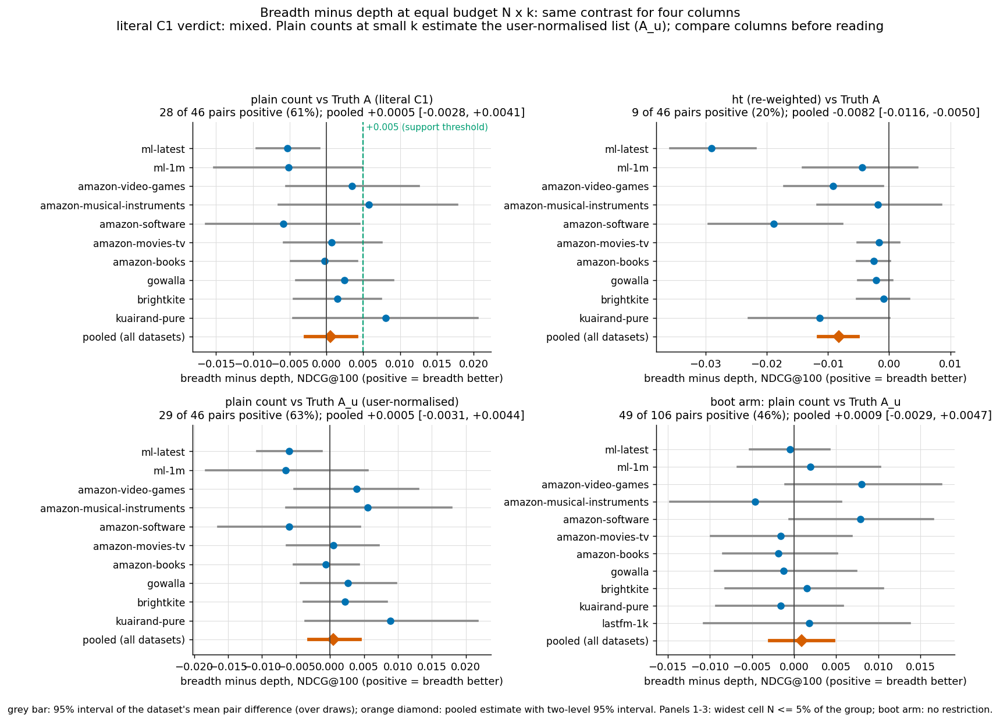

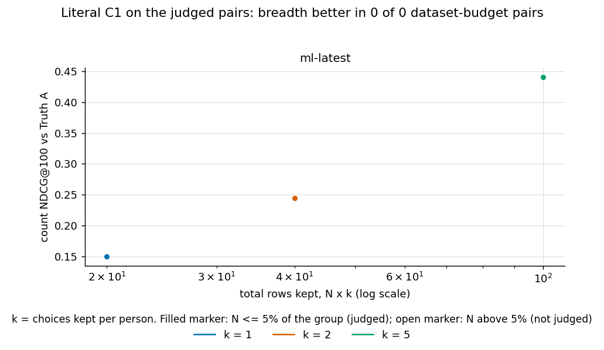

#### C2. 只用样本自己选权重的混合名单，不比较好的单一名单差，有时还胜过两者（修订规则 A11） — **不支持**

在 132 个格子中，用时间留出法选权重的混合名单与较好的单一名单（取流行度与个性化(时间)两者格子均值较大者）相差不超过 0.002 的占 70%（要求至少 90%）；配对 95% 区间在 0 之上的占 25%（要求至少 20%）；在 78 个可判定的格子中，随机留出法比时间留出法给个性化更大权重的抽样次数占多数的格子占 38%（要求至少 70%，不超过 50% 则被证伪；另有 12 个格子因两种留出法每次都选了相同的模型和权重、42 个格子因不并列的抽样少于 5 次而被排除）。

*事先定好的规则：* (a) hybrid_time cell mean >= larger of (popularity, personalised_time) cell means - 0.002 in >= 90% of cells; (b) paired-by-draw 95% interval of hybrid_time minus that pure list above 0 in >= 20% of cells; (c) per cell, draws with hybrid_random.w > hybrid_time.w vs <, ties dropped, >= 5 untied draws, identical-split cells excluded; 'random more' larger in >= 70% of eligible cells. Supported if a>=90%, b>=20%, c>=70%; falsified if a<75% or b<10% or c<=50%; else mixed

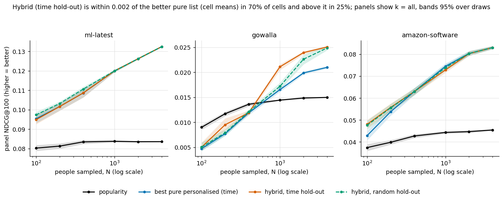

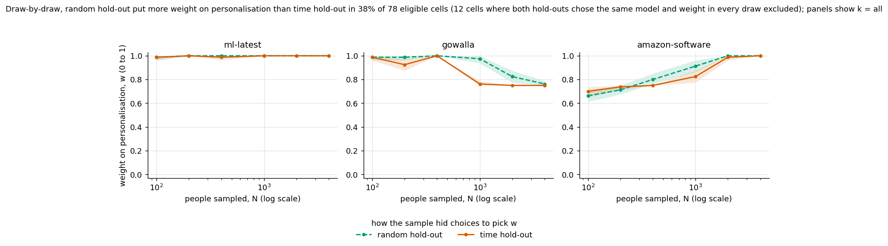

#### C3. 存在一个交叉样本量，并且 k = 全部 时不比 k = 10 时更大（修订规则 A12） — **混合**

在 k = 全部 时，7 个数据集中有 5 个存在交叉样本量 N*（个性化模型显著胜过流行度，且在更大的 N 上均值差保持为正；要求至少 5 个；至少 4 个不存在则被证伪）；k = 10 时有 3 个（要求至少 4 个）。N* 没有出现 k = 全部 大于 k = 10 的情况。 候选集占比低于 0.5（受候选集上限限制）：ml-latest, amazon-video-games, amazon-musical-instruments, amazon-software, gowalla。

*事先定好的规则：* N*(k), k in {10, all} = smallest N whose paired-by-draw 95% interval of personalised_time - popularity is above 0 AND whose mean difference stays > 0 at every larger tested N; absent counts as larger than any present N*; supported if N* exists at k=all in >= 5 of 7 and at k=10 in >= 4 of 7 and N*(all) > N*(10) never happens; falsified if absent at k=all in >= 4 of 7; else mixed

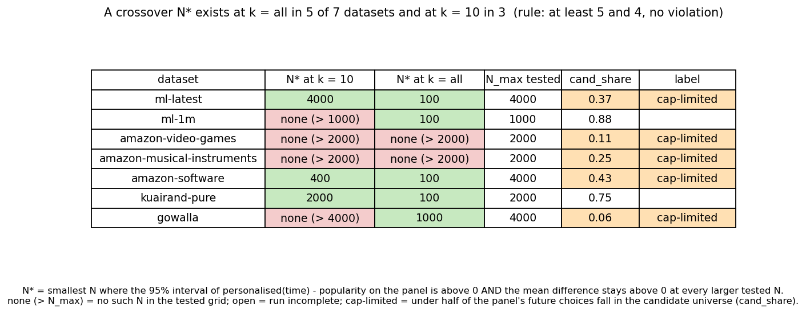

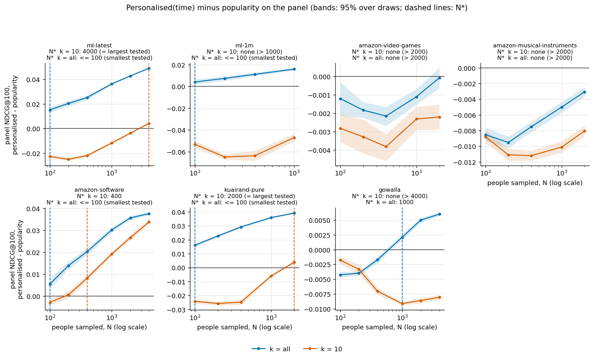

### C2/C3 的配套检验：候选集内得分与更小的样本量

这一块背后的数字：`results/small_sample_popularity/03_tables/an_c3_checks_*.csv` 和 `an_c3_checks_verdicts.json`。

#### C3-in-universe. C3 交叉样本量：候选集内得分版（C3 的配套，修订 A15） — **混合**

只统计模型够得着的相关物品（候选集 1,500 个物品之内）时，k=all 下 7 个数据集中 6 个存在 N*（标准得分：5 个），k=10 下 3 个（标准：3 个）。结果发生变化的序列：amazon-video-games/k=all。这说明'热门更好'的结果有多少是候选集上限造成的。

*事先定好的规则：* Same N* rule as C3 (A12) on U_ndcg_in; companion, not a registered verdict.

#### C3-small-N. 交叉点到底从哪里开始？把 C3 的网格向下延伸到 N=20 — **混合**

加入三个更小的样本量（20、40、60 人）后，k=all 时交叉点移到 100 以下的数据集有 3 个；ml-latest：<= 20 (smallest tested)；ml-1m：100；amazon-video-games：none (> 2000)；amazon-musical-instruments：none (> 2000)；amazon-software：<= 20 (smallest tested)；kuairand-pure：<= 20 (smallest tested)；gowalla：1000。

*事先定好的规则：* N* as in A12, on the grid {20, 40, 60} + the registered grid; exploratory.

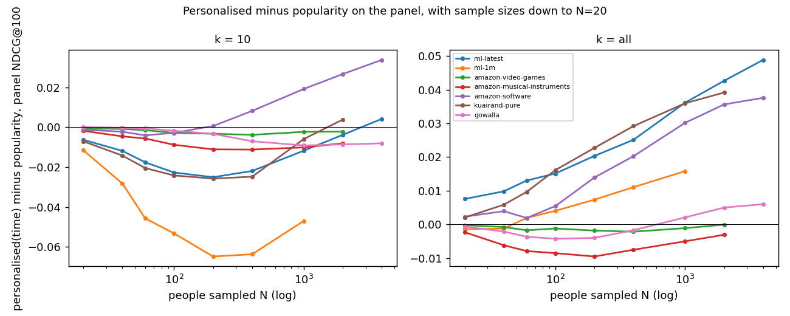

### 探索性：旧榜、收缩和近期加权（窗口真相）

这一块背后的数字：`results/small_sample_popularity/03_tables/an_window_*.csv` 和 `an_window_verdicts.json`。

#### X1. 探索性 X1（窗口真相）：在样本人数达到群体的较大比例之前，旧榜单优于来自同一时间窗口的新样本榜单 — **不支持**

以“窗口”（新样本所取自的同一段时间）为标准，保留全部过往选择（k=all）时，在已抽样的 N 范围内，新样本在 11 个数据集中有 11 个追平了旧榜单；追平发生处的中位数约为群体的 1%。需要群体至少 30% 才追平的判定数：k=all 0/11，k=5 0/9（前 100 名重合度：k=all 0/11，k=5 0/8）。这是探索性结果，每格抽样次数不多，单个交叉点有噪声。

*事先定好的规则：* Crossover N_s >= 30% of the group in most datasets (N_s = smallest N whose mean window-sample count score >= the stale list's score on the window truth; judged on W_ndcg100 at k=5 and k=all, both must agree; W_ov100 reported as a robustness check)

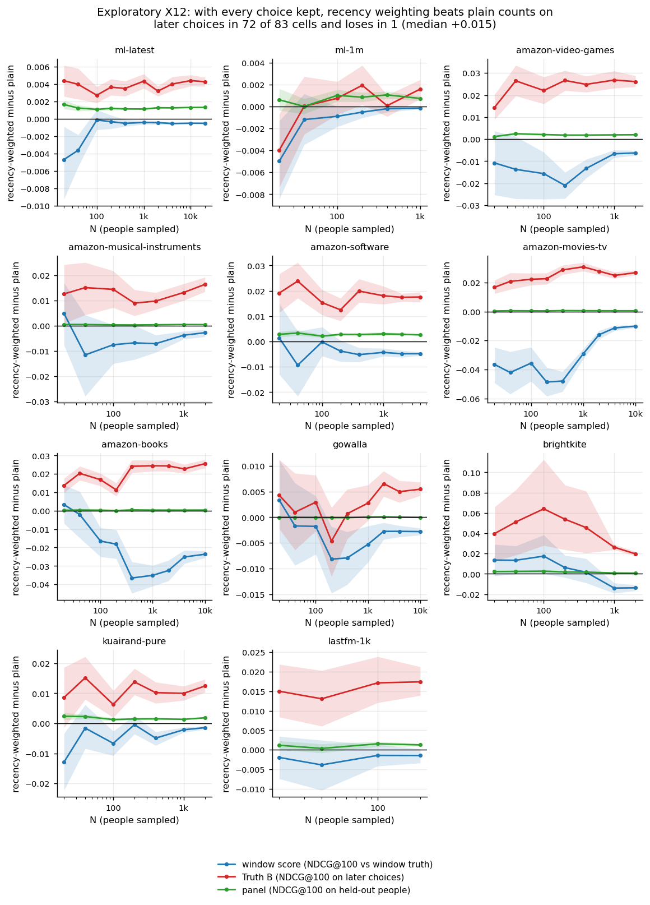

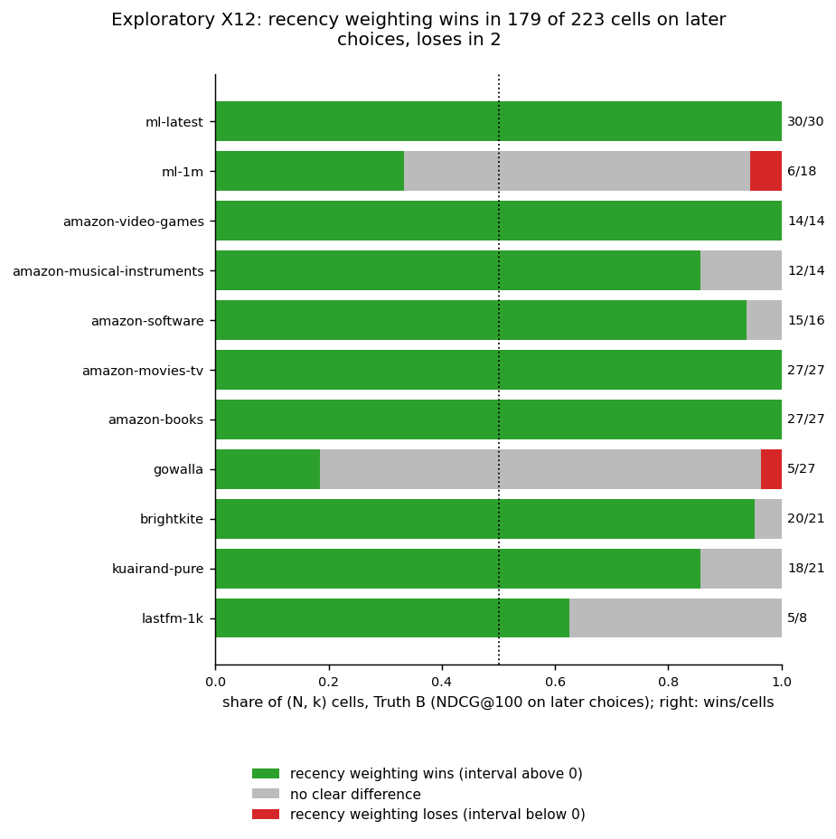

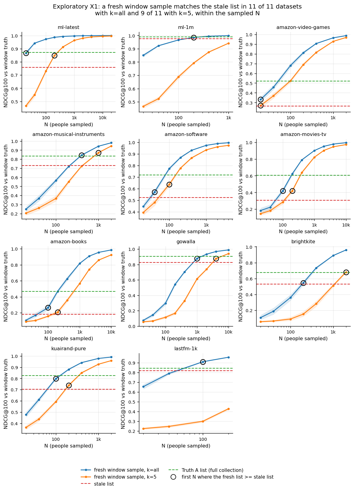

#### X2. 探索性 X2（窗口真相）：向旧榜单收缩在交叉点附近帮助最大 — **不支持**

把来自窗口的新样本向旧榜单收缩，对窗口真相的 NDCG@100 最多提高 0.763，增益峰值的中位数 N 为 20。增益峰值与 X1 交叉点相差不超过一格的情况：k=all 2/11，k=5 1/9（只有交叉点已出现的数据集才能判定）。各格收缩强度 kappa 的中位数为 16,965；kappa 越大，方法越依赖旧榜单。

*事先定好的规则：* Gain of shrinking toward the stale list (shrunk minus count, window score W_ndcg100) peaks near the X1 crossover (peak at the crossover grid point or one grid step away; judged only where the crossover is reached inside the grid; k=5 and k=all must agree, verdict from the majority of judged datasets per k)

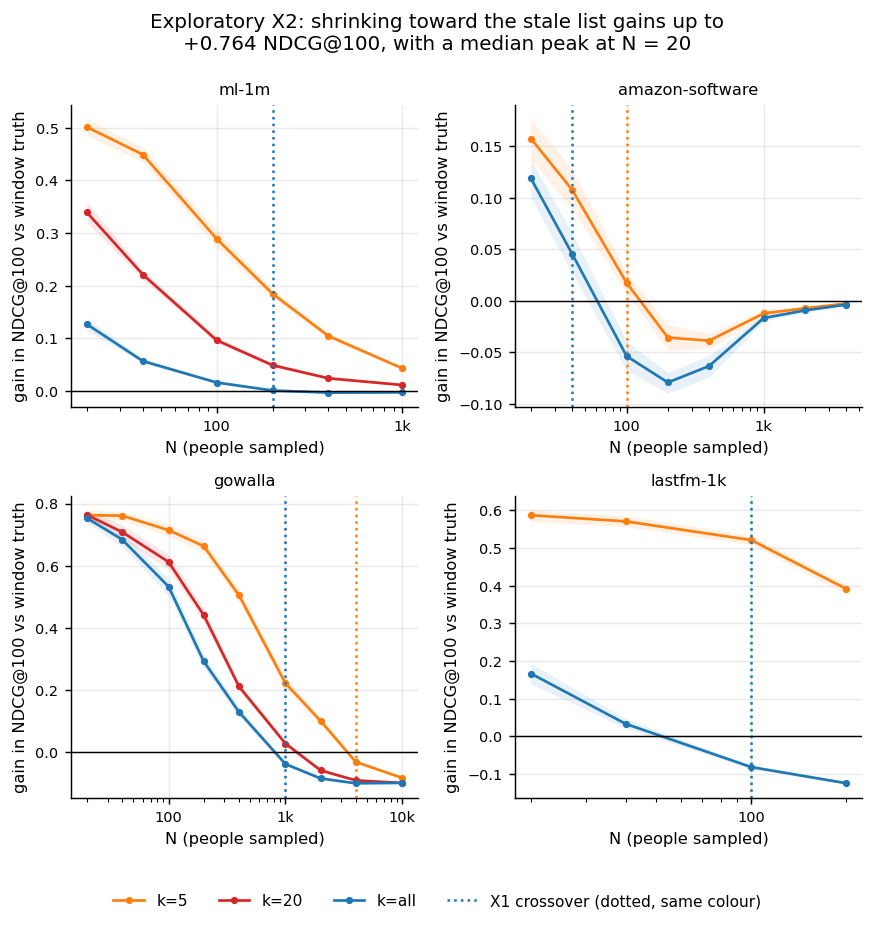

#### X12. 探索性 X12：更看重近期选择有助于预测之后的选择 — **支持**

更看重近期选择，在 223 个格子中有 179 个（80%）预测之后真实选择（Truth B）的效果好于普通计数榜单，2 个更差，42 个看不出差别；所有格子的中位差为 +0.013（NDCG@100）。窗口得分上胜 15、负 119（共 223），留出面板上胜 179、负 3（共 223）。这是探索性结果，共 11 个有窗口样本的数据集。

*事先定好的规则：* Share of (dataset, N, k) cells where recency-weighted counts beat plain counts on Truth B (B_ndcg100) with the 95% bootstrap interval of the difference above 0 (cells with >= 2 draws): supported if more than 50% of judged cells, not supported if fewer than 25%, else mixed; cells with the interval below 0 are reported as losses

### 探索性：缩放规律、理论检验、漂移

这一块背后的数字：`results/small_sample_popularity/03_tables/an_explore_a_*.csv` 和 `an_explore_a_verdicts.json`。

#### X3. 探索性 X3：误差按带下限的幂律下降，且指数与齐普夫斜率同序 — **混合**

NDCG@100 误差指数与齐普夫斜率的等级相关：k=all 为 0.54（11 个数据集），k=5 为 0.76（11 个）；预测值是高于 0.6。数据集数量少，相关系数噪声大。

*事先定好的规则：* Rank correlation of the power-law exponent and the Zipf slope above 0.6 across the datasets (judged on NDCG@100 error, k=all and k=5; needs >= 5 converged datasets)

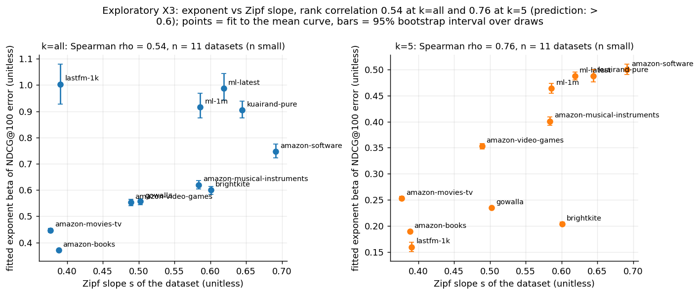

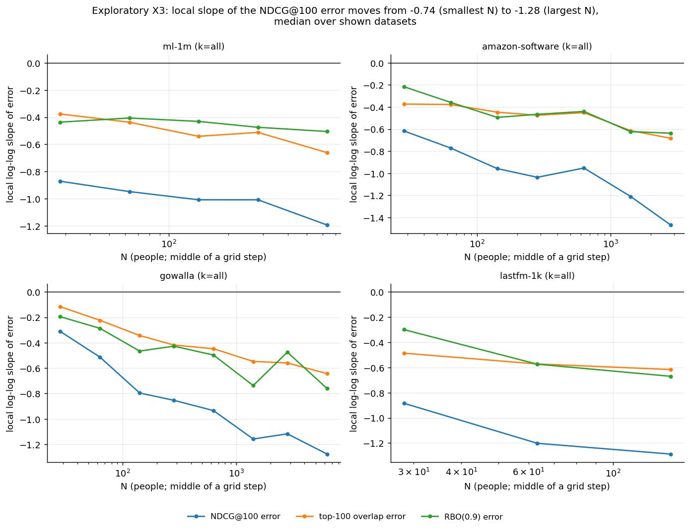

#### X4. 探索性 X4：Dyer-Owen 界是保守的 — **无法检验**

e1 数据中没有保存“实际排对的前几名数量”，因此该规则无法按原文检验。这里只给出代理指标：预测的“排清所需 N”与前 10 名重合度首次达到 0.8 的 N（k=all）。在已抽样的 N 范围内，11 个数据集中有 10 个的前 10 名重合度达到 0.8；而该界预测需要 15,535 到 21,065,359 人才能排清前 10 名；代理结果：9 个未被推翻，0 个超出预测，0 个无法判断。

*事先定好的规则：* Observed correctly ordered depth >= the Dyer-Owen bound at every N (cannot be read from e1 rows; proxy only)

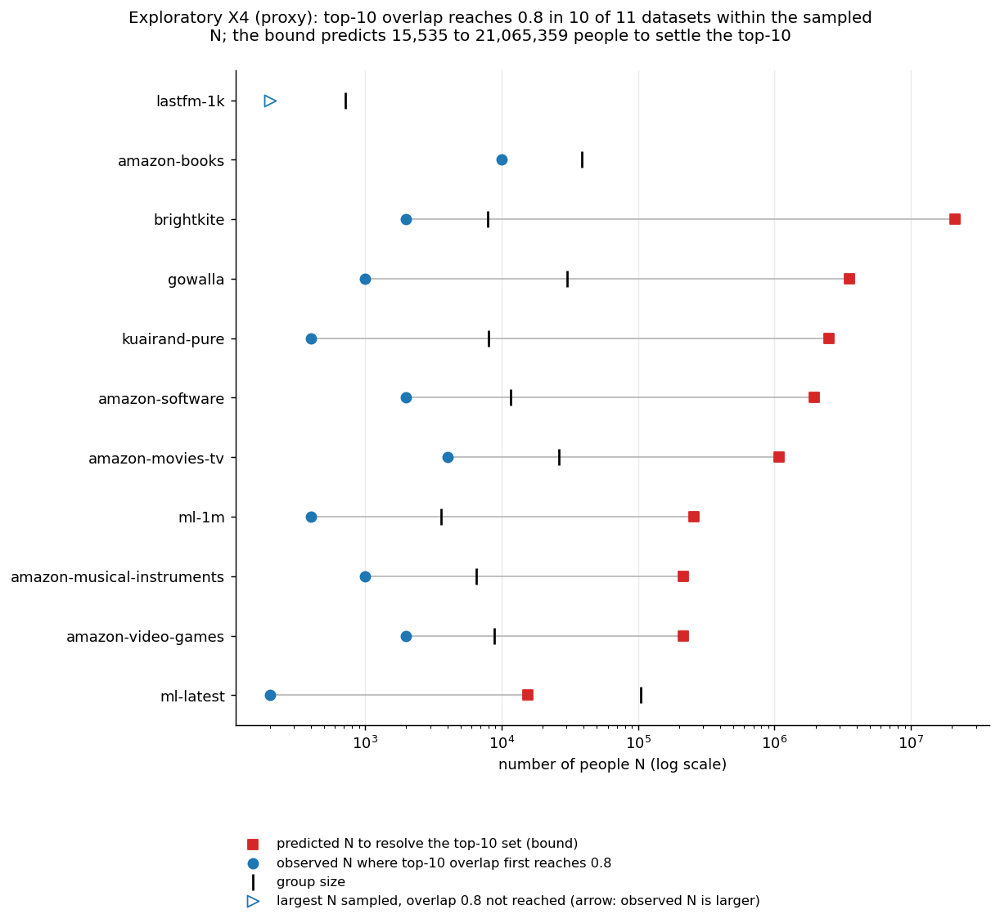

#### X10. 探索性 X10：真相 A 与真相 B 之间的漂移大于抽样误差 — **支持**

按面板得分，在 N=1000 时漂移差距大于抽样差距的数据集为 10/10（漂移中位数 0.021，抽样中位数 0.000）；按对真相榜单的 NDCG@100 为 10/10（漂移中位数 0.658，抽样中位数 0.003）。在最大 N 处分别为 10/11 和 11/11。

*事先定好的规则：* Drift gap (Truth A vs Truth B oracle lists) exceeds the sampling gap in most datasets (judged at N=1000, k=all; measures: panel NDCG@100 and NDCG@100 vs the truth lists)

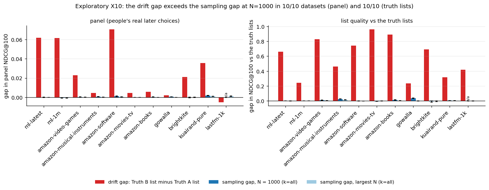

### 探索性：排名置信集、有偏抽样、近期偏好、子群体、隐私

这一块背后的数字：`results/small_sample_popularity/03_tables/an_explore_b_*.csv` 和 `an_explore_b_verdicts.json`。

#### X5（探索性）：排名区间的覆盖率与宽度，朴素自助法与 Mogstad 区间对比 — **支持**

在 42 个格子里，朴素区间对真实第 51-200 名的覆盖率中位数只有 0.85，79% 的格子低于 0.93；Mogstad 区间覆盖率中位数 1.00，100% 的格子达到 0.95。Mogstad 区间的宽度约为朴素区间的 3.0 倍。

*事先定好的规则：* Naive coverage below 0.93 in the ranks 51-200 band in most cells (> 50% of (dataset,N,k) cells); Mogstad coverage at least 0.95 in most cells.

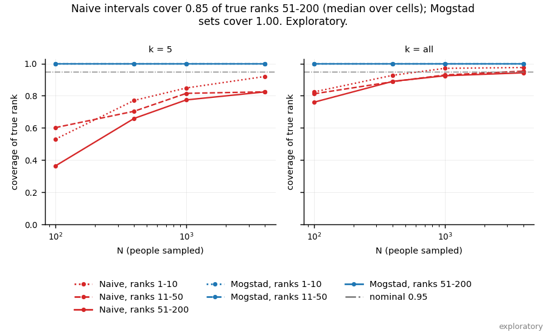

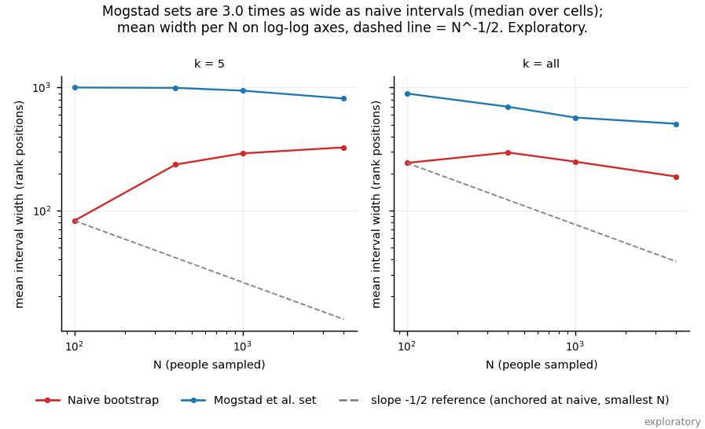

#### X6（探索性）：按活跃度有偏抽样下，未校正计数与加权（HT）计数对比 — **不支持**

出现“交叉点”（最小 N 时未校正计数不落后，之后加权计数明显领先）的情况：activity：11 个数据集中有 2 个（29 条数据集-k 系列中有 10 条）；inv_activity：11 个数据集中有 1 个（29 条数据集-k 系列中有 4 条）。有交叉点时，交叉 N 的中位数约为 1000；有 40 条系列加权计数始终没有赢。

*事先定好的规则：* A crossover N exists in most datasets: the weighted (HT) count beats the uncorrected count (95% CI of the paired difference above 0) from some N on, while the uncorrected count is not behind at the smallest N.

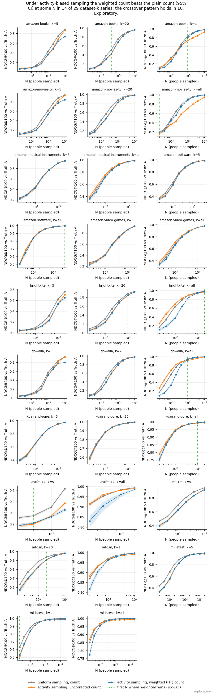

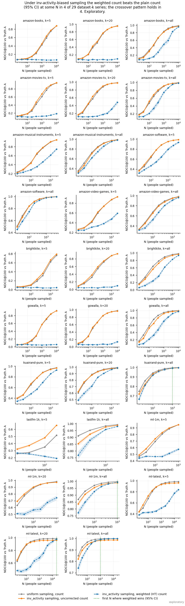

#### X7（探索性）：最近选择的样本与均匀样本在真值 A、真值 B 上的比较 — **支持**

recent_rows：真值 A 差 -0.060，真值 B 差 0.048（最近 减 均匀，NDCG@100 均值），11 个数据集中 8 个符号相反；recent_window：真值 A 差 -0.163，真值 B 差 0.060（最近 减 均匀，NDCG@100 均值），11 个数据集中 10 个符号相反。符号相反指对真值 A 更差、对真值 B 更好。

*事先定好的规则：* Opposite signs in most datasets: recent-choice samples are worse than uniform ones on Truth A and better on Truth B (difference of mean NDCG@100, averaged over the (N,k) cells).

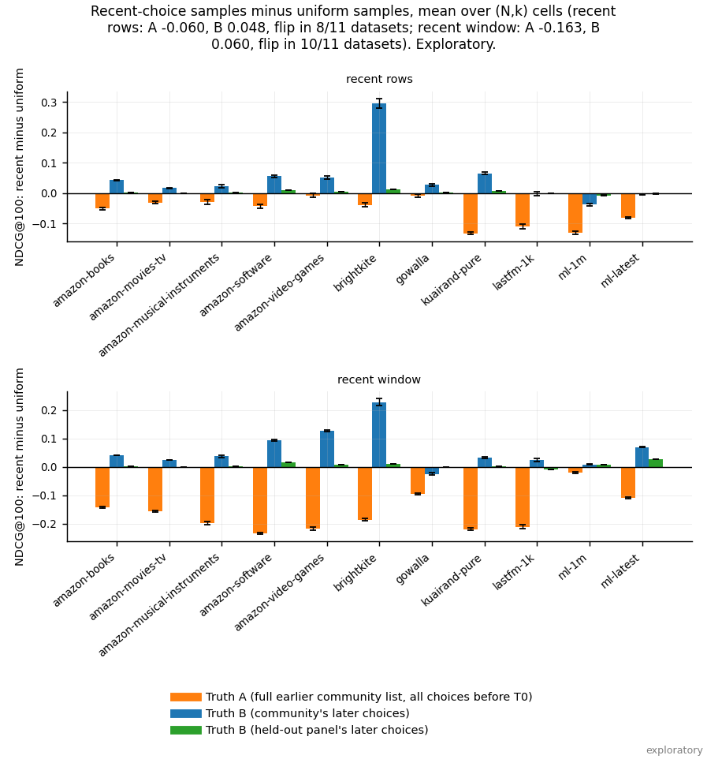

#### X8（探索性）：子群体榜单（仅样本、全局、收缩）以及 N** 与差异度的关系 — **不支持**

在 164 条（群体，k）系列中，差异度与 N** 的 Spearman 相关为 -0.44（95% 区间 -0.56 到 -0.31）；有 70 条系列中仅用样本的榜单始终没有超过全局榜单（记为大于最大 N）。收缩榜单在每个 N 上都不差于样本榜与全局榜中较好者的系列占 7%（单个格子占 58%）。

*事先定好的规则：* Positive rank correlation (Spearman, across groups) between distinctiveness (1 - group_vs_global_ov100) and N** (smallest N where the sample-only list beats the global list). Supported if rho > 0 and the 95% bootstrap interval (over groups) excludes 0; mixed if rho > 0 but the interval includes 0.

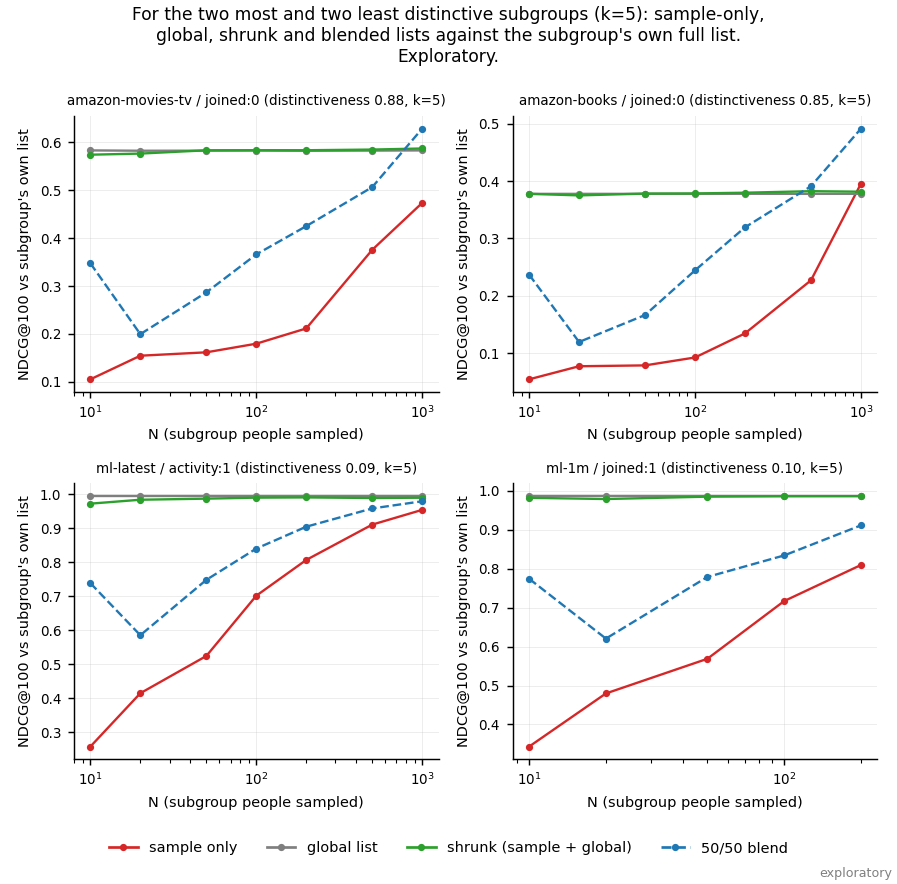

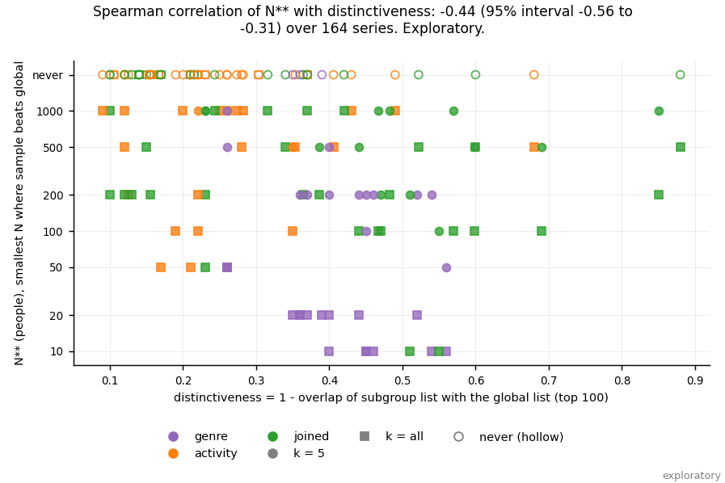

#### X9（探索性）：用样本量衡量隐私噪声的代价，中心化与本地化、头部与尾部 — **混合**

中心化差分隐私（eps≥2，N≥2000）保留约 0.86 的有效人数；本地差分隐私（eps≥2）需要多出约 50 倍的人数（只是下限：这些格子中有 87% 低于非隐私曲线的最小 N）。隐私噪声使前 10 名重合度中位下降 96%，前 100 名重合度下降 93%（49% 的格子里头部损失更大）。

*事先定好的规则：* Statements in sample-size ratios, per dataset. Operational reading (fixed in advance): (a) head: private relative loss in ov10 exceeds that in ov100 in most cells; (b) central DP (laplace, gaussian) at eps >= 2 and N >= 2000 has median effective-N ratio >= 0.8; (c) local DP (ldp_oue) at eps >= 2 needs a median of at least 30x more people.

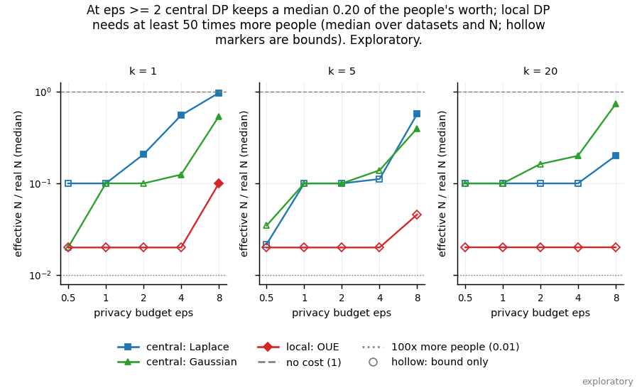

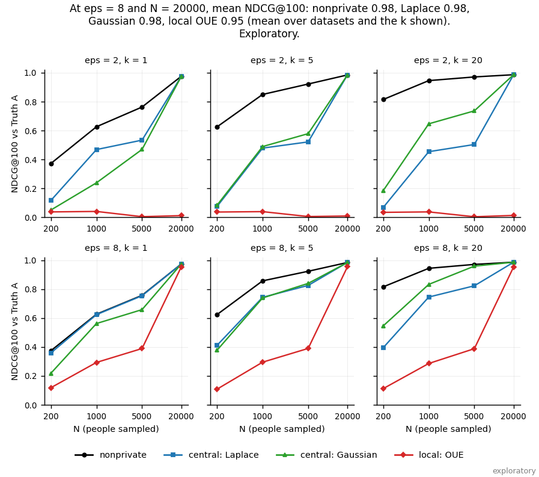

### 对我们最初解释的后续检验

这一块背后的数字：`results/small_sample_popularity/03_tables/an_followups_*.csv` 和 `an_followups_verdicts.json`。

#### F1. 广度让榜单更稳定，但并没有让它更好 — **描述性**

总选择数相同时，46 个对里有 39 个，宽格子在不同抽样之间的榜单质量标准误更小（中位数比值 0.88），而平均质量相同（C1）。广度换来的是稳定性，不是准确性。

*事先定好的规则：* Descriptive follow-up to C1; no registered threshold.

#### F2. 子群体：去掉从未达到交叉点的序列后，反向的符号仍然存在，但变弱 — **描述性**

在子群体样本确实胜过全局榜的 94 个序列里，差异度与取胜所需样本量的秩相关为 -0.20（区间 -0.37 到 -0.01）；从未达到的 70 个序列平均差异度更低（0.26 对 0.39），这就是第一个数字（-0.44）被夸大的原因。

*事先定好的规则：* Descriptive follow-up to X8; no registered threshold.

#### F3. 样本内留出检验几乎不比「永远猜更常见的结果」好 — **描述性**

个性化在验证小组上胜过热门的抽样占 33%，所以永远猜更常见的结果，对的比例是 67%；按时间留出的样本内检验对的比例是 68%。几乎没有增加判断力。

*事先定好的规则：* Descriptive follow-up to X16; no registered threshold.

#### F4. 近期抽样：群体之后的榜单提升很多，留出的人只提升一点点 — **描述性**

近期窗口样本对群体之后的榜单，比同样大小的均匀样本好，NDCG@100 中位数 +0.037；但对留出的人只好 +0.0023，并且在 11 个数据集里有 2 个为负（gowalla, lastfm-1k）。

*事先定好的规则：* Descriptive follow-up to X7; no registered threshold.

### 探索性：惊喜搜索与新种子复现

这一块背后的数字：`results/small_sample_popularity/03_tables/an_hunt_*.csv` 和 `an_hunt_verdicts.json`。

#### x11_c1_nonmonotone. 意外发现搜索：1 学习曲线随样本变大反而变差（探索性） — **支持**

共扫描24159个这类假设（所有类别合计40356个），443个通过假发现率控制；用新抽样重跑的20个中有20个重现（同方向且单侧p<0.05）。只有重现的才算发现，且仍属探索性。

*事先定好的规则：* X11 (exploratory, pre-registered): scan every curve for non-monotone shapes and sign reversals; Benjamini-Hochberg q=0.10 within the class; each hit re-run on fresh seeds, reported as found / replicated / not replicated. Class verdict rule (fixed before use): supported = at least half of ALL FDR hits of the class replicate (hits that could not be re-run count as not replicated); mixed = some but fewer; not supported = no FDR hit or none replicated; not testable = hits not yet re-run or cells missing.

#### x11_c2_signflip. 意外发现搜索：2 不同评价目标上结论相反（探索性） — **无法检验**

共扫描1872个，253个通过假发现率控制，但新数据里缺少对应格子，无法重跑，因此都不算发现。

*事先定好的规则：* X11 (exploratory, pre-registered): scan every curve for non-monotone shapes and sign reversals; Benjamini-Hochberg q=0.10 within the class; each hit re-run on fresh seeds, reported as found / replicated / not replicated. Class verdict rule (fixed before use): supported = at least half of ALL FDR hits of the class replicate (hits that could not be re-run count as not replicated); mixed = some but fewer; not supported = no FDR hit or none replicated; not testable = hits not yet re-run or cells missing.

#### x11_c3_reversal. 意外发现搜索：3 两种估计方法随样本变大互换名次（探索性） — **支持**

共扫描1630个这类假设（所有类别合计40356个），325个通过假发现率控制；用新抽样重跑的6个中有6个重现（同方向且单侧p<0.05）。只有重现的才算发现，且仍属探索性。

*事先定好的规则：* X11 (exploratory, pre-registered): scan every curve for non-monotone shapes and sign reversals; Benjamini-Hochberg q=0.10 within the class; each hit re-run on fresh seeds, reported as found / replicated / not replicated. Class verdict rule (fixed before use): supported = at least half of ALL FDR hits of the class replicate (hits that could not be re-run count as not replicated); mixed = some but fewer; not supported = no FDR hit or none replicated; not testable = hits not yet re-run or cells missing.

#### x11_c4_interaction. 意外发现搜索：4 交互作用（人数×每人条数；广度与深度）（探索性） — **支持**

共扫描7647个这类假设（所有类别合计40356个），1802个通过假发现率控制；用新抽样重跑的20个中有20个重现（同方向且单侧p<0.05）。只有重现的才算发现，且仍属探索性。

*事先定好的规则：* X11 (exploratory, pre-registered): scan every curve for non-monotone shapes and sign reversals; Benjamini-Hochberg q=0.10 within the class; each hit re-run on fresh seeds, reported as found / replicated / not replicated. Class verdict rule (fixed before use): supported = at least half of ALL FDR hits of the class replicate (hits that could not be re-run count as not replicated); mixed = some but fewer; not supported = no FDR hit or none replicated; not testable = hits not yet re-run or cells missing.

#### x11_c5_heterogeneity. 意外发现搜索：5 不同数据集上效果方向相反（探索性） — **支持**

共扫描482个这类假设（所有类别合计40356个），189个通过假发现率控制；用新抽样重跑的4个中有4个重现（同方向且单侧p<0.05）。只有重现的才算发现，且仍属探索性。

*事先定好的规则：* X11 (exploratory, pre-registered): scan every curve for non-monotone shapes and sign reversals; Benjamini-Hochberg q=0.10 within the class; each hit re-run on fresh seeds, reported as found / replicated / not replicated. Class verdict rule (fixed before use): supported = at least half of ALL FDR hits of the class replicate (hits that could not be re-run count as not replicated); mixed = some but fewer; not supported = no FDR hit or none replicated; not testable = hits not yet re-run or cells missing.

#### x11_c6_valley. 意外发现搜索：6 混合比两端都差（探索性） — **不支持**

共扫描993个这类假设（所有类别合计40356个），没有一个通过假发现率控制，因此不作为发现报告。

*事先定好的规则：* X11 (exploratory, pre-registered): scan every curve for non-monotone shapes and sign reversals; Benjamini-Hochberg q=0.10 within the class; each hit re-run on fresh seeds, reported as found / replicated / not replicated. Class verdict rule (fixed before use): supported = at least half of ALL FDR hits of the class replicate (hits that could not be re-run count as not replicated); mixed = some but fewer; not supported = no FDR hit or none replicated; not testable = hits not yet re-run or cells missing.

#### x11_c7_diverging. 意外发现搜索：7 样本变大对两个目标作用相反（探索性） — **无法检验**

共扫描2442个，27个通过假发现率控制，但新数据里缺少对应格子，无法重跑，因此都不算发现。

*事先定好的规则：* X11 (exploratory, pre-registered): scan every curve for non-monotone shapes and sign reversals; Benjamini-Hochberg q=0.10 within the class; each hit re-run on fresh seeds, reported as found / replicated / not replicated. Class verdict rule (fixed before use): supported = at least half of ALL FDR hits of the class replicate (hits that could not be re-run count as not replicated); mixed = some but fewer; not supported = no FDR hit or none replicated; not testable = hits not yet re-run or cells missing.

#### x11_c8_noisehelps. 意外发现搜索：8 加噪声反而更好（探索性） — **不支持**

共扫描1131个这类假设（所有类别合计40356个），没有一个通过假发现率控制，因此不作为发现报告。

*事先定好的规则：* X11 (exploratory, pre-registered): scan every curve for non-monotone shapes and sign reversals; Benjamini-Hochberg q=0.10 within the class; each hit re-run on fresh seeds, reported as found / replicated / not replicated. Class verdict rule (fixed before use): supported = at least half of ALL FDR hits of the class replicate (hits that could not be re-run count as not replicated); mixed = some but fewer; not supported = no FDR hit or none replicated; not testable = hits not yet re-run or cells missing.

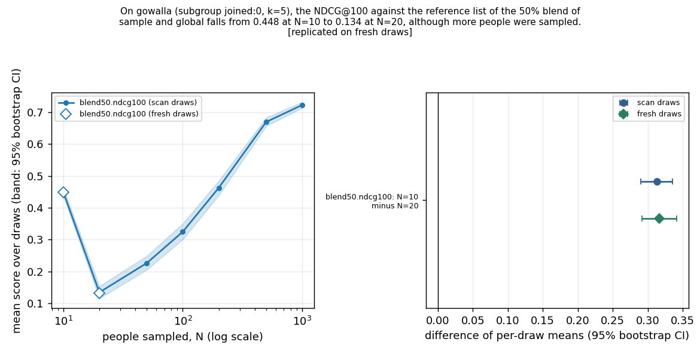

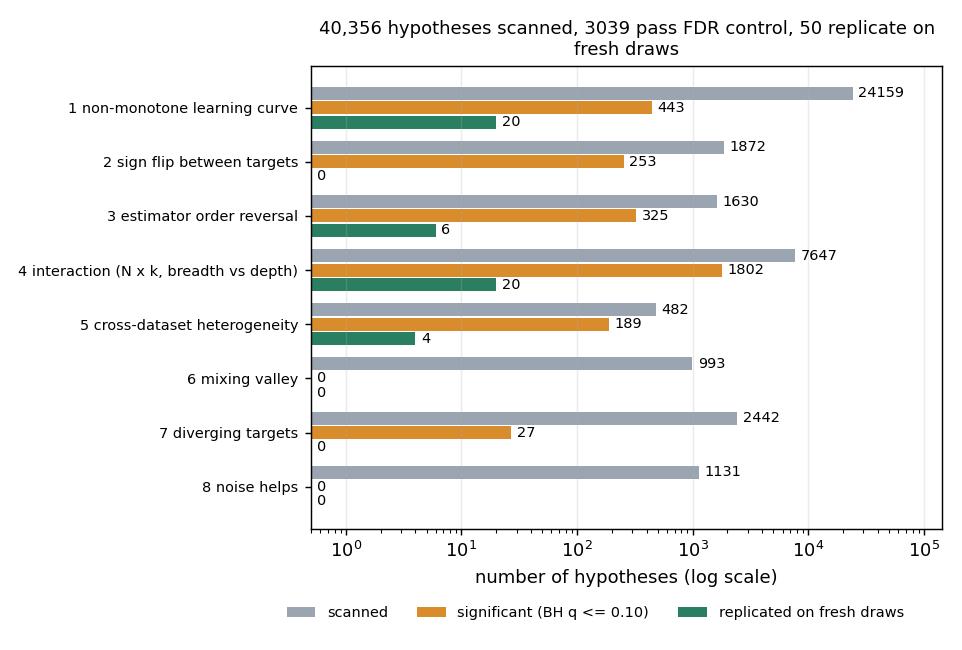

### 探索性：历史长度与训练深度、自我评估、无偏与朴素计数

这一块背后的数字：`results/small_sample_popularity/03_tables/an_extra_*.csv` 和 `an_extra_verdicts.json`。

#### X13. 探索性 X13：交叉点样本量主要由展示给用户的历史长度决定，而不是由训练深度决定 — **无法检验**

在 kprof=all 时，同时有 k_train=5 和 k_train=all 交叉点的数据集少于 4 个（knn100：3，ease100：2，现有数据共 7 个数据集），所以暂时无法判定。各 N* 见表格。

*事先定好的规则：* Per dataset and model (knn100, ease100) vs pop at stratum=all, kprof=all: N*(k_train) = smallest N whose paired-by-draw 95% interval of (model - pop) is above 0 and whose mean stays above 0 at every larger N. Supported if N*(k_train=5) is within one grid step of N*(k_train=all) in >= 5 of the datasets that have an N* for both; not supported if they differ by >= 2 steps in >= 4 of them; not testable if fewer than 4 datasets have an N* for both; else mixed. Models are combined (supported only if both are).

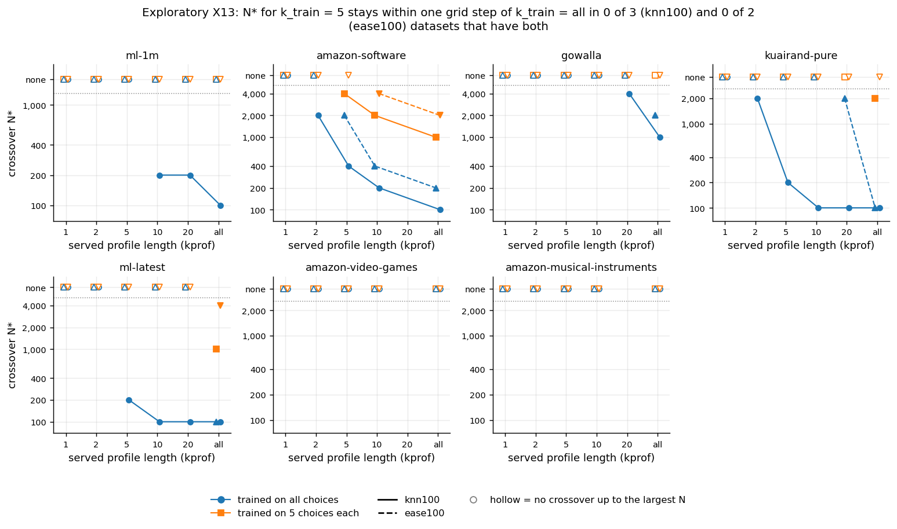

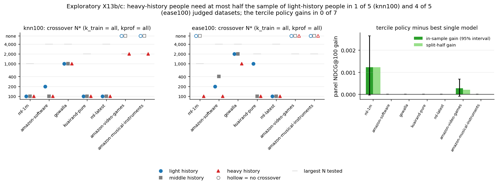

#### X13b. 探索性 X13b：历史长的人比历史短的人在更小的样本量下就能从个性化中受益 — **混合**

历史长的人所需样本量不超过历史短的人的一半的情况：knn100：5 个可判定数据集中有 1 个；ease100：5 个可判定数据集中有 4 个。两组都有 N* 时，重度/轻度的中位数比值为 1.00（共 9 个）。

*事先定好的规则：* Per dataset and model, kprof=all, k_train=all: ratio = N*(heavy tercile) / N*(light tercile). 'Far smaller' = ratio <= 0.5; a light tercile with no N* counts as N* above the largest tested N (so a heavy N* at most half the largest N counts as far smaller; a heavy N* above that is not judged). Datasets with no N* in either tercile are not judged. Supported if far smaller in strictly more than half of the judged datasets; models combined.

#### X13c. 探索性 X13c：按历史长度三分位分别选最优模型，优于只用一个最优模型 — **不支持**

在最大 N 处，按三分位选模型的策略优于最优单一模型（95% 区间在 0 以上且折半检验为正）的数据集有 0/7 个（样本内增益中位数 0.0000 NDCG@100，折半检验 0.0000）。选择与打分用的是同一批抽样，样本内增益偏乐观；折半检验才是公平的检查。

*事先定好的规则：* Per dataset at the largest N with >= 4 draws, kprof=all, k_train=all: tercile policy = for each tercile the model (of pop, ease100, knn100, ease50, knn50) with the best cell mean; best single policy = the one model with the best mean over the three terciles. Gain = per-draw paired difference of the tercile-average scores. A dataset counts when the 95% interval of the gain is above 0 AND the split-half gain (choose on even draws, score on odd draws, and the reverse) is above 0. Supported if so in strictly more than half of the datasets.

#### X14. 探索性 X14：单个样本自己的自助法能按正确尺度预测榜单质量，而按行的自助法不能 — **混合**

按用户的自助法在 N≥200 的每个格子里，预测/真实比值的中位数都落在 [0.67, 1.5] 内的数据集有 6/6 个（比值中位数 1.00）；按行的自助法与之相比、配对区间不含 0 的格子占多数的数据集有 6/6 个（比值中位数 1.00）。跨抽样来看，预测与真实质量的秩相关达到 0.5 以上的数据集有 0/6 个（Spearman 中位数 0.18）。按 N 的有符号误差（预测减真实）见表格。

*事先定好的规则：* Against Truth A (real_A), cells with N >= 200. (1) user-level bootstrap 'calibrated' in a dataset if the median pred/real ratio over draws lies in [0.67, 1.5] in every (N >= 200, k) cell; supported if so in strictly more than half of the datasets. (2) row-level bootstrap 'mis-scaled relative to the user-level one' in a dataset if the paired-by-draw 95% interval of (pred_row - pred_user) excludes 0 in more than half of its N >= 200 cells; supported if so in strictly more than half of the datasets. (3) Spearman correlation across draws of pred_user vs real_A: a dataset passes if the median over its N >= 200 cells is >= 0.5 (cells with >= 5 draws and non-constant values); supported if so in strictly more than half of the datasets. The three parts are combined (supported only if all are).

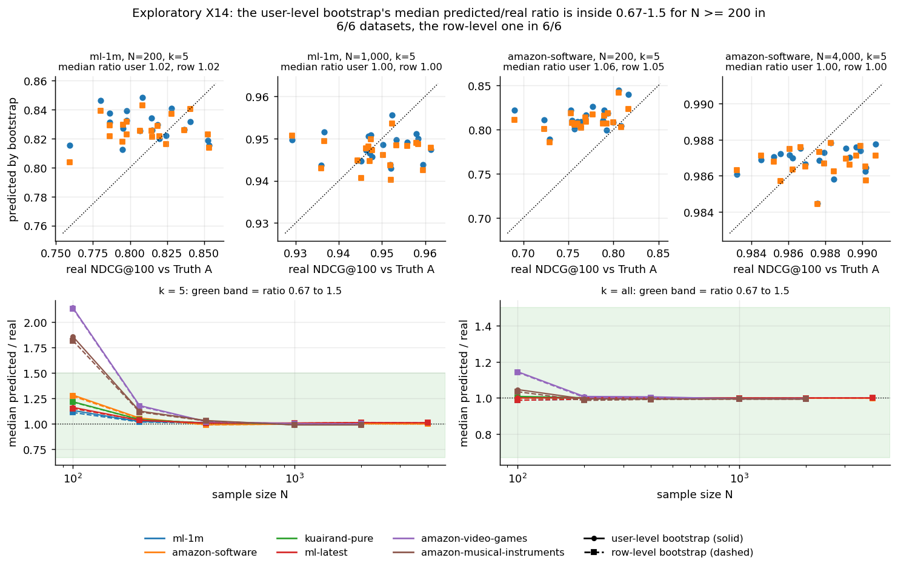

#### X15. 探索性 X15：无偏的加权计数即便能胜过普通计数，也只发生在样本很大时 — **支持**

在 50 个数据集与 k 的组合中，有 47 个里加权的 `ht` 在对 Truth A 的得分上从不胜过普通 `count`，或者只有在 N 达到群体 10% 以上时才胜过（从不胜过：46；在 10% 以前就胜过：3；从不胜过的组合中有 0 个测试的最大 N 不到群体的 10%，只能算下界）。在最大 N 处 ht 减 count 的中位数为 -0.1248 NDCG@100，ht 领先的组合为 4/50。

*事先定好的规则：* For each dataset and numeric k: N_win is the smallest N where the independent-draw bootstrap 95% interval of (ht - count) for A_ndcg100 is above 0 (2000 resamples); 'never' if no N qualifies. Supported if, in strictly more than half of the dataset-k series, ht never wins or wins only at N >= 10% of the group. A_u results are shown beside it and do not enter the verdict.

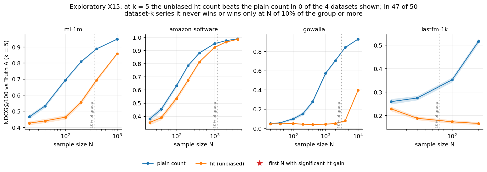

### 探索性：两种学习速度

这一块背后的数字：`results/small_sample_popularity/03_tables/an_curves_*.csv` 和 `an_curves_verdicts.json`。

#### X17. 两种速度：热门榜很早就饱和，个性化模型还在继续提升（探索性） — **支持**

从 N=100 到最大被测 N，热门榜在验证小组上的得分中位数增长 1.22 倍，而最好的纯个性化模型增长 1.94 倍；7 个数据集中，有 4 个里热门榜至少提早两个网格步就达到了自身最好成绩的 95%。

*事先定好的规则：* In more than half of the judged datasets, the sample size where the popularity list reaches 95% of its own best is at least two grid steps below that of the best pure personalised model (k = all, panel NDCG@100).

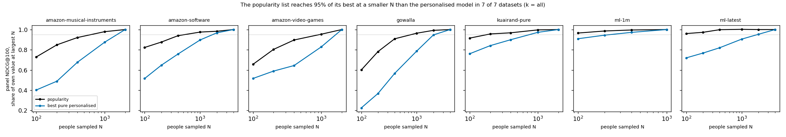

### 探索性：来自样本内部的切换规则

这一块背后的数字：`results/small_sample_popularity/03_tables/an_stoprule_*.csv` 和 `an_stoprule_verdicts.json`。

#### X16. 样本自己能否判断何时个性化开始划算？（探索性） — **不支持**

把每个被抽中者最新的选择藏起来，预测个性化在真实验证小组上是否有帮助，准确率为 68%（随机藏：68%）。随机藏平均高估个性化的好处 +0.017 NDCG，按时间藏为 +0.014。

*事先定好的规则：* Time-ordered in-sample gap predicts the sign of the panel gap with accuracy >= 0.80, and its AUC beats the random hold-out's (interval over datasets above 0).

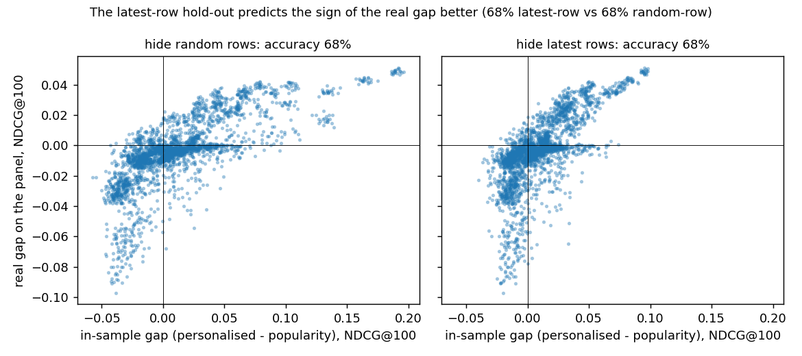
